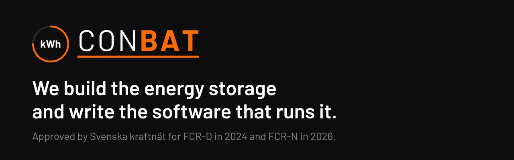

  

Conbat AB builds energy storage from batteries out of electric and hybrid cars, in Falkenberg, Sweden. The hardware and the software are our own. Both Svenska kraftnät approvals, FCR-D and FCR-N, were passed on the first attempt.

## What we build

| Part | What it is |
|---|---|
| **Energy storage** | Containerised battery storage with second-life cells from electric and hybrid cars, or new LFP cells rated 6 000+ cycles. Insulated enclosure with a heat pump that keeps the cells at 15–25 °C. |
| **Circuit boards** | Every board in the system is designed in-house. |
| **SmartEMS** | The energy management system on every site. It charges the battery when the spot price is low, uses it when the price is high, cuts demand peaks and delivers frequency reserves to Svenska kraftnät. |
| **Conbat Siteflow** | The customer app, on the [App Store](https://apps.apple.com/se/app/conbat-siteflow/id6806745442) and [Google Play](https://play.google.com/store/apps/details?id=se.conbat.siteflow). It shows a site in real time. It controls no equipment. |
| **Integration** | REST, MQTT, Modbus TCP and Modbus RTU. |

## Facts you can check

| Fact | Detail | Where to check it |
|---|---|---|
| **Grid services** | Approved for FCR-D in 2024 and FCR-N in 2026 | Svenska kraftnät |
| **Company** | Conbat AB, org.nr 559552-4991, founded 2020 | Bolagsverket |
| **Office** | Skogstorp 405, 311 91 Falkenberg, Sweden | Bolagsverket |

## Code

Our repositories are private, because they run customer sites. Anything we release publicly will appear on this page.

## Contact

[conbat.se](https://conbat.se) &nbsp;&nbsp; [info@conbat.se](mailto:info@conbat.se)
